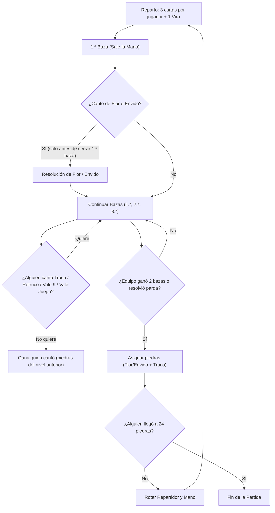

# Documento de Reglas, Cantos y Mecánicas: Truco Venezolano

> Especificación funcional y de diseño para implementar un juego de **Truco Venezolano** con baraja española en **PixiJS**.

---

## 1. Resumen General de la Partida

| Aspecto | Detalle |
| :--- | :--- |
| **Baraja** | Española de **40 cartas** (del 1 al 7, Sota `10`, Caballo `11`, Rey `12`). Se excluyen los `8`, `9` y comodines. |
| **Palos (Pintas)** | **Espadas**, **Bastos**, **Oros** y **Copas**. |
| **Modalidades** | **1 vs 1** (*mano a mano*) y **2 vs 2** (*en parejas*, modalidad clásica). *(Opcional: 3 vs 3 con modalidad "pica y pica")*. |
| **Unidad de puntaje** | **Piedras** (puntos). |
| **Meta de victoria** | **24 piedras** (divididas en **12 malas** + **12 buenas**) o partida rápida a **12 piedras**. |
| **Estructura** | Cada partida se compone de múltiples **manos**. En cada mano se reparten 3 cartas por jugador y se disputan hasta **3 bazas** junto con los lances de **Envido / Flor** y **Truco**. |

### Roles en cada Mano
- **Repartidor (Pie en 1v1):** Baraja, reparte 3 cartas a cada jugador y voltea **la Vira**. En la siguiente mano el rol rota en sentido antihorario (hacia la derecha, tradicional en mesa venezolana; o configurable).
- **Mano:** Es el jugador situado inmediatamente después del repartidor. Es el **primero en jugar** en la primera baza y tiene **ventaja en caso de empate** en Envido, Flor o triple parda.

---

## 2. La Vira, el Perico y la Perica (Las Piezas)

El rasgo más distintivo del **Truco Venezolano** es **la Vira** (también llamada *muestra*):

1. Después de repartir 3 cartas a cada jugador, se voltea la siguiente carta del mazo y se coloca boca arriba en la mesa. Esa carta es **la Vira**.
2. El palo (pinta) de la Vira determina las dos cartas más poderosas de toda la mano, llamadas **piezas**:
   - **El Perico (1.ª carta más alta):** Es el **Caballo (`11`)** del palo de la Vira.
   - **La Perica (2.ª carta más alta):** Es la **Sota (`10`)** del palo de la Vira.
3. **Regla especial cuando la Vira es una pieza:**
   - Si la Vira resulta ser el **Caballo (`11`)**, el **Rey (`12`)** de ese mismo palo pasa a ser el **Perico**.
   - Si la Vira resulta ser la **Sota (`10`)**, el **Rey (`12`)** de ese mismo palo pasa a ser la **Perica**.

> **Nota para el motor:** La Vira nunca entra en la mano de ningún jugador, pero el palo de la Vira debe quedar siempre visible sobre el mazo en la mesa.

---

## 3. Jerarquía de Cartas para el Truco

Ordenadas de **mayor (rango 14)** a **menor (rango 1)**. Las cartas en el mismo nivel empatan entre sí (*baza parda*):

| Nivel | Fuerza | Carta(s) | Nombre tradicional |
| :---: | :---: | :--- | :--- |
| 1 | `14` | **Caballo (11) de la Vira** *(o Rey si Vira=11)* | **Perico** |
| 2 | `13` | **Sota (10) de la Vira** *(o Rey si Vira=10)* | **Perica** |
| 3 | `12` | **1 de Espadas** | **Espadilla** |
| 4 | `11` | **1 de Bastos** | **Bastillo** |
| 5 | `10` | **7 de Espadas** | Siete de Espadas |
| 6 | `9` | **7 de Oros** | Siete de Oros |
| 7 | `8` | **3** de cualquier palo | Treses |
| 8 | `7` | **2** de cualquier palo | Doses |
| 9 | `6` | **1 de Copas** y **1 de Oros** | Ases falsos / Perros |
| 10 | `5` | **12 (Reyes)** restantes | Reyes |
| 11 | `4` | **11 (Caballos)** restantes (no Perico) | Caballos |
| 12 | `3` | **10 (Sotas)** restantes (no Perica) | Sotas |
| 13 | `2` | **7 de Copas** y **7 de Bastos** | Sietes falsos |
| 14 | `1` | **6**, **5**, **4** (en orden descendente: `6 > 5 > 4`) | Cartas bajas / negras |

*(Para implementación en código, `6`, `5` y `4` tienen fuerzas distintas: `6 > 5 > 4`, es decir, 16 niveles numéricos del `1` al `16`.)*

---

## 4. Mecánica de una Mano y Reglas de las Bazas

### Flujo de una Mano

### Reglas de las 3 Bazas
- En cada baza, cada jugador activo lanza **1 carta** sobre la mesa en orden de turno.
- Gana la baza el equipo que haya jugado la carta de mayor jerarquía.
- **Quién sale en la siguiente baza:**
  - En la **1.ª baza**, sale el jugador que es **Mano**.
  - En la **2.ª y 3.ª baza**, sale el jugador que **ganó la baza anterior**.
  - Si la baza anterior fue **parda**, vuelve a salir quien salió primero en la baza empatada (o la Mano).
- **Victoria de la mano:** Gana el lance del Truco el primer equipo en ganar **2 bazas**.

### Reglas de Empate (Baza Parda)
Cuando la carta más alta de ambos equipos en una baza tiene la misma fuerza, la baza se declara **parda**:

| Situación | Ganador de la Mano |
| :--- | :--- |
| **Parda en 1.ª baza** | Gana quien gane la **2.ª baza**. |
| **Parda en 1.ª y 2.ª baza** | Gana quien gane la **3.ª baza**. |
| **1.ª baza ganada por Equipo A, 2.ª parda** | Gana **Equipo A** inmediatamente (no se juega la 3.ª). |
| **1.ª baza Equipo A, 2.ª Equipo B, 3.ª parda** | Gana **Equipo A** (quien ganó la primera baza). |
| **Triple parda (1.ª, 2.ª y 3.ª empatadas)** | Gana el equipo que es **Mano**. |

### Acciones Especiales en Turno
- **Irse al mazo:** Un jugador (o equipo) puede rendirse en su turno si cree que no puede ganar. El rival se lleva las piedras correspondientes al estado actual del Truco (1 piedra si no se cantó Truco, o el valor del último nivel aceptado). Si aún no se jugó el Envido y el rival se va al mazo antes de la 1.ª carta, se otorga 1 piedra extra por el envido no disputado (o según variante de mesa).
- **Quemar / tapar una carta:** Un jugador puede tirar una carta **boca abajo** para ocultar información (por ejemplo, ocultar que tenía cartas del mismo palo o no revelar qué guardó). Una carta tapada tiene fuerza `0` (pierde contra cualquier carta boca arriba).

---

## 5. Los Cantos y Apuestas

En el Truco Venezolano existen **tres lances** principales: **Envido**, **Flor** y **Truco**.

---

### 5.1. El Envido (El Tanto)

Se juega comparando la puntuación de las cartas en mano. **Solo puede cantarse en la primera baza**, antes de que el jugador haya tirado su primera carta (o en 2v2, por cualquiera de los jugadores del turno que aún no haya jugado su primera carta, generalmente el pie).

#### Cálculo del Puntaje del Envido
Valores base de cada carta para el Envido:
- Cartas del `1` al `7`: valen su **valor numérico** (`1` a `7`).
- Figuras comunes (`10`, `11`, `12` que **no** sean Perico ni Perica): valen **`0`**.
- **Perica:** vale **`29`** (actúa como comodín de palo y ya incluye el bono de +20).
- **Perico:** vale **`30`** (actúa como comodín de palo y ya incluye el bono de +20).

**Fórmula exacta (orden de evaluación):**
1. Si tienes **Perico + Perica**: es **Flor Reservada** (no se juega Envido común, se canta Flor).
2. Si tienes **1 pieza (Perico o Perica)** y las otras dos cartas son de distinto palo:
   $$\text{Envido} = \text{ValorPieza} + \max(\text{valor}(c_1), \text{valor}(c_2))$$
   - Máximo con Perico + `7`: `30 + 7 = 37`.
   - Máximo con Perica + `7`: `29 + 7 = 36`.
   *(Nota: si las otras dos cartas son del mismo palo entre sí, tienes **Flor**, no Envido).*
3. Si **no tienes piezas**, pero tienes **2 cartas del mismo palo**:
   $$\text{Envido} = 20 + \text{valor}(c_1) + \text{valor}(c_2)$$
   - Máximo sin piezas: `7 + 6 + 20 = 33`.
   - Dos figuras del mismo palo (ej. Rey y Sota de copas): `20 + 0 + 0 = 20`.
4. Si **no tienes piezas** y las **3 cartas son de palos distintos**:
   $$\text{Envido} = \max(\text{valor}(c_1), \text{valor}(c_2), \text{valor}(c_3))$$
   - Rango posible: `0` a `7`.

#### Desempate en el Envido
Si ambos equipos empatan en puntaje exacto (por ejemplo, ambos tienen `31`), **gana el equipo que es Mano** (o en 2v2, el jugador más cercano a la Mano en orden de turno).

#### Escalada y Piedras del Envido

| Canto / Escalada | Si se dice *"Quiero"* (ganador) | Si se dice *"No quiero"* (quien cantó) |
| :--- | :---: | :---: |
| **Envido** | **2 piedras** | **1 piedra** |
| **Envido → Quiero y envido** | **4 piedras** | **2 piedras** |
| **Envido 5 piedras** | **5 piedras en total**, de entrada o como subida | **1** de entrada, **2** sobre envido o **4** sobre quiero y envido |
| **Envido la falta** | Piedras que le faltan al equipo que va **ganando** para llegar a la meta configurada (12 o 24) | Piedras del nivel anterior (1 de entrada, o 2, 4 o 5) |

> *Nota sobre Falta Envido en Malas y Buenas:* En la regla tradicional venezolana, si el equipo líder aún está en **malas** (< 12 piedras), la falta suele valer lo que le falta para llegar a 12 (entrar en buenas) o directamente lo que le falta para 24 según acuerdo de mesa. Conviene hacerlo configurable en el menú de partida.

#### Regla: *"El Envido está primero"*
Si en la primera baza el Jugador A canta **Truco** antes de que se haya disputado el Envido (y el Jugador B aún no ha tirado su primera carta), el Jugador B puede ignorar momentáneamente el Truco y responder ***"¡Envido!"*** (o ***"¡Flor!"***). Primero se resuelve el Envido/Flor y luego el Jugador B decide si quiere o no el Truco.

---

### 5.2. La Flor

La Flor es una jugada especial que **anula automáticamente cualquier Envido**.

#### Condiciones para tener Flor
Un jugador tiene Flor si cumple cualquiera de estos 3 casos:
1. **Flor común (3 del mismo palo):** Sus 3 cartas son del mismo palo.
2. **Flor con pieza:** Tiene **2 cartas del mismo palo** + el **Perico** o la **Perica** (la pieza actúa como comodín del palo de las otras dos).
3. **Flor Reservada:** Tiene el **Perico + la Perica** + cualquier tercera carta. Es la flor máxima e invencible.

#### Cálculo del Puntaje de la Flor (cuando dos jugadores tienen Flor)
1. **Flor Reservada:** Gana automáticamente a cualquier otra flor. *(En una baraja única solo puede existir una Flor Reservada por mano).*
2. **Flor con pieza (2 mismo palo + Perico/Perica):**
   $$\text{Puntos Flor} = \text{ValorPieza (30 o 29)} + \text{valor}(c_1) + \text{valor}(c_2)$$
   - Máximo con Perico + `7` + `6`: `30 + 7 + 6 = 43`.
3. **Flor común (3 cartas del mismo palo, sin piezas):**
   $$\text{Puntos Flor} = 20 + \text{valor}(c_1) + \text{valor}(c_2) + \text{valor}(c_3)$$
   - Máximo sin piezas (`7` + `6` + `5`): `20 + 7 + 6 + 5 = 38`.
4. **Empate entre flores:** Gana quien esté más cerca de la **Mano**.

#### Declaración Obligatoria y Cantos de «A Ley» / «Con Ley» / «Sin Ley»
- **Regla general:** Si un jugador tiene Flor, debe cantarla en su turno durante la primera baza antes de jugar su primera carta (o inmediatamente si el rival canta Envido). Si no la canta a tiempo, pierde el derecho a reclamar sus piedras.
- **Canto «¡A Ley!» (solo la Mano):** El jugador que es **Mano** (primero en jugar en la 1.ª baza; nunca el Pie) puede declarar **«¡A Ley!»** antes de lanzar su primera carta:
  - **Si tiene Flor:** Posterga el anuncio de su Flor para sorprender al rival; queda **obligado a cantarla antes de jugar su 2.ª carta** (o antes de responder/cantar Truco o Envido), de lo contrario **pierde la Flor**.
  - **Si no tiene Flor:** Puede declarar «¡A Ley!» como jugada táctica (*paquete* / engaño) y jugar su carta o cantar **«¡A ley, Envido!»** (a lo que el rival sin Flor responde **«¡Sin ley, quiero!»**).

#### Cantos, Respuestas y Piedras de la Flor

| Situación / Canto | Quién responde | Piedras en juego |
| :--- | :--- | :--- |
| **¡Flor!** (el rival no tiene Flor) | Rival no tiene flor | **3 piedras** para quien cantó. |
| **Flor Reservada** *(NO se canta "Flor Reservada")* | Ningún rival puede igualarla | **5 piedras**; se guarda en silencio hasta el final de la mano (o se responde simplemente *"¡Flor!"* / *"¡Con flor envido!"* sin delatar las piezas). |
| **Con flor no quiero** | Rival también tiene Flor, pero decide no disputarla | **4 piedras** para quien cantó primero *(3 de su flor + 1 por achicarse el rival)*. |
| **Con flor envido** | Rival también tiene flor y reta a comparar tantos | **5 piedras** (3 por flor y 2 por envite). Si se rechaza, el retador cobra 4. |
| **Con flor envido la falta** | Apuesta máxima entre flores | Las piedras que faltan al equipo que va adelante. Si se rechaza, se cobran 4 al abrir el envite con la falta o 5 al subir desde «Con flor envido». |

---

### 5.3. El Truco (Escalada Venezolana)

El Truco apuesta sobre quién ganará las **3 bazas** de la mano. A diferencia del truco argentino (que escala 2 → 3 → 4), el **Truco Venezolano escala de 3 en 3 hasta Vale Juego**:

| Nivel | Canto | Si se acepta (*"¡Quiero!"*) | Si se rechaza (*"No quiero"*) |
| :---: | :--- | :---: | :---: |
| 0 | *(Sin cantar)* | **1 piedra** | — |
| 1 | **¡Truco!** | **3 piedras** | **1 piedra** |
| 2 | **¡Retruco!** | **6 piedras** | **3 piedras** |
| 3 | **¡Vale Nueve!** | **9 piedras** | **6 piedras** |
| 4 | **¡Vale Juego!** *(o Vale Partido)* | **Gana la partida completa** *(piedras restantes hasta 24)* | **9 piedras** |

#### Reglas de la Escalada del Truco
- **Posesión del "Quiero" (La Voz):** Solo el equipo que **aceptó** el último canto puede subir al siguiente nivel. El mismo equipo no puede cantar *Truco* y luego cantar *Retruco* sin que el rival haya respondido primero.
- **Respuesta inmediata:** Ante un canto de Truco, el rival tiene 3 opciones:
  1. **Quiero:** Acepta el valor y conserva el derecho a subir el canto más adelante en la mano.
  2. **Subir el canto** (ej. responder *"¡Quiero Retruco!"* directamente): Acepta implícitamente el nivel anterior y pasa la decisión del nuevo nivel al rival.
  3. **No quiero:** La mano termina inmediatamente y el equipo que cantó cobra las piedras del nivel anterior.
- **Cuándo se puede cantar:** En tu turno, en cualquiera de las 3 bazas (antes o después de jugar, siempre que no hayas terminado la mano).

---

## 6. Sistema de Puntuación: Piedras, Malas y Buenas

- En Venezuela los puntos se llevan tradicionalmente con **piedritas, semillas o granos** (de ahí el nombre **piedras**).
- Una partida completa a **24 piedras** se divide en dos mitades:
  - **Las Malas:** de `0` a `12` piedras.
  - **Las Buenas:** de `13` a `24` piedras (en el marcador visual suele representarse reiniciando el conteo de `1` a `12` en la zona de *Buenas*).
- **Orden de asignación al cierre de la mano:** Si en la misma mano ambos equipos están a punto de ganar el partido (por ejemplo, Equipo A gana el Envido y Equipo B gana el Truco), **siempre se anotan primero los puntos de Flor/Envido** y **después los del Truco**. Si un equipo llega a 24 con el Envido/Flor, gana la partida de inmediato aunque luego perdiera el Truco.

---

## 7. Las Señas (Mecánica para 2 vs 2)

En partidas de **parejas (2 vs 2)**, los compañeros se comunican secretamente mediante gestos faciales llamados **señas** para coordinar qué cartas tienen y si conviene cantar Envido o Truco.

| Carta / Jugada | Seña tradicional venezolana |
| :--- | :--- |
| **Perico** | Levantar ambas cejas |
| **Perica** | Guiñar un ojo |
| **Espadilla (1 de Espadas)** | Abrir/estirar la boca o sacar la punta de la lengua |
| **Bastillo (1 de Bastos)** | Hacer un gesto con el labio inferior / arrugar la nariz |
| **7 de Espadas** | Torcer la boca hacia la derecha |
| **7 de Oros** | Torcer la boca hacia la izquierda |
| **Tres (3)** | Morderse el labio inferior |
| **Dos (2)** | Fruncir los labios (dar un beso) |
| **Ases falsos (1 Copas/Oros)** | Abrir mucho los ojos |
| **Flor** | Inflar una mejilla / gesto de soplar |
| **Ciego (cartas malas)** | Cerrar los ojos brevemente |

> **Idea de mecánica en PixiJS (2v2):** El jugador puede abrir un menú rápido de señas para enviárselas a su compañero (IA o humano). El avatar ejecuta una micro-animación facial durante 1 segundo; si un rival observa atento, puede interceptar la seña (o incluso se pueden enviar señas falsas para engañar / *hacer paquete*).

---

## 8. Casos de Borde y Opciones Configurables

Para que el motor de reglas sea sólido y sin ambigüedades, conviene definir estas reglas y configuraciones:

1. **Verificación de cartas (Sin Mentiras en Envido/Flor):**
   - En la implementación digital, el motor calcula automáticamente si un jugador tiene Flor y cuál es su puntaje exacto de Envido/Flor, evitando trampas o errores de conteo.
   - Si el Envido se disputa ("Quiero"), las cartas relevantes se revelan al final de la mano (o en un resumen de puntos) para transparencia.
2. **Prohibición de mentir sobre tener Flor:** El botón `¡Flor!` solo se habilita si el jugador efectivamente posee Flor válida.
3. **Configuraciones de mesa recomendadas:**
   - **Modo de juego:** `1 vs 1` (ideal para el MVP inicial) | `2 vs 2` (expansión con señas).
   - **Meta de piedras:** `12 piedras` (rápida) | `24 piedras` (estándar: 12 malas + 12 buenas).
   - **Con Flor / Sin Flor:** Activado por defecto (auténtico Truco Venezolano).
   - **Regla de Falta Envido en Malas:** `Falta hasta 12` (clásico) vs `Falta hasta 24` (directo).

---

## 9. Guía de Arquitectura para el Desarrollo en PixiJS

Antes de escribir código, se recomienda separar estrictamente la **lógica del juego** de la **capa visual en PixiJS**:

### 9.1. Motor de Reglas (TypeScript puro, sin PixiJS)
- `deck.ts`: Generación y barajado (Fisher-Yates) de las 40 cartas españolas + selección de la Vira.
- `evaluator.ts`:
  - `getPerico(vira)` y `getPerica(vira)` (incluyendo el caso especial cuando la Vira es `10` o `11`).
  - `getCardTrucoRank(card, vira)`: devuelve valor numérico `1..16`.
  - `hasFlor(hand, vira)` y `isFlorReservada(hand, vira)`.
  - `calculateEnvido(hand, vira)` y `calculateFlor(hand, vira)`.
  - `resolveTrick(playedCards, vira)` y `resolveHandWinner(trickResults, manoTeam)`.
- `stateMachine.ts`: Máquina de estados finitos que controla fases (`DEALING`, `PLAYING_TRICK`, `AWAITING_ENVIDO_RESPONSE`, `AWAITING_FLOR_RESPONSE`, `AWAITING_TRUCO_RESPONSE`, `HAND_OVER`, `MATCH_OVER`), turnos, validez de cantos y acumulación de piedras.
- `ai.ts`: Oponente bot con evaluación de fuerza de mano, probabilidades de Envido/Flor, gestión de *bluff* (engaño) y decisiones de Truco.

### 9.2. Capa Visual e Interacción (PixiJS v8)
- **Mesa de juego:** Tapete verde/madera con textura, mazo al costado con **la Vira** sobresaliendo boca arriba.
- **Cartas de baraja española:** Sprites/texturas vectoriales o spritesheet con diseño clásico (Espadas, Bastos, Oros, Copas) + badge o brillo dorado sutil sobre el **Perico** y la **Perica** para facilitar la lectura al jugador.
- **Animaciones:** Reparto desde el mazo, volteo de la Vira, *hover* y levantamiento de cartas en mano, lanzamiento con rotación natural sobre la mesa, volteo para cartas quemadas.
- **UI de Cantos y Marcador:**
  - Botonera contextual que solo muestra cantos válidos según el estado actual (`Envido`, `Flor`, `Truco`, `Retruco`, `Vale Nueve`, `Vale Juego`, `Quiero`, `No Quiero`, `Al Mazo`).
  - Globos de diálogo animados con la jerga venezolana (*"¡Truco!"*, *"¡Quiero Retruco!"*, *"¡Envido 5 piedras!"*, *"¡Con flor envido!"*).
  - Marcador visual de **Piedras** dividido en **Malas (1–12)** y **Buenas (13–24)**.
